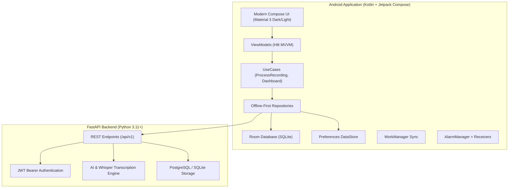

# CallPilot — AI-Powered Call Assistant & Smart Reminders

> **CallPilot** is an AI-powered personal call management and intelligent reminder Android app, designed as a companion product in the **CraftN** executive suite alongside **Lead N CRM**.

---

## Key Features

1. **Compliant In-App Audio Recording**
   - Foreground service with real-time waveform visualization and notification channel compliance.
   - Recording consent workflow ensuring legal compliance for permitted conversations.
   - Clean audio playback with playback progress tracking.

2. **AI-Powered Speech-to-Text Transcription**
   - Speaker diarization (distinguishing User vs Client).
   - High-confidence multi-language transcription.
   - Searchable transcript viewer with timecode jumps.

3. **Intelligent Conversation Recaps**
   - Executive bullet summaries.
   - Key discussion points and commitments tracking (Client vs User agreements).
   - Sentiment analysis and client purchase intent scoring.
   - One-tap professional follow-up message generation (ready for SMS/Email/WhatsApp).

4. **Automated Reminders & Scheduling**
   - Action items automatically extracted from call transcript and scheduled.
   - Exact alarms using Android `AlarmManager` with `USE_EXACT_ALARM`.
   - Rich notifications with action buttons (**Complete** and **Snooze 15m**).
   - Boot persistence receiver to ensure reminders survive device reboot.

5. **Conversational AI Assistant**
   - Chat assistant capable of querying past calls, drafting proposals, and recommending daily follow-up priorities.

6. **Offline-First Architecture**
   - Local Room database with encrypted DataStore token storage.
   - Background periodic data synchronization via WorkManager (`SyncWorker`).

---

## Architecture & Tech Stack



---

## Project Structure

```
callpilot/
├── android/                        # Android Studio Project
│   ├── app/
│   │   ├── src/main/
│   │   │   ├── java/com/craftn/callpilot/
│   │   │   │   ├── CallPilotApp.kt
│   │   │   │   ├── MainActivity.kt
│   │   │   │   ├── data/          # Room DB, DAOs, Entities, Retrofit DTOs & Services
│   │   │   │   ├── di/            # Hilt Modules (Database, Network, Repositories)
│   │   │   │   ├── domain/        # Models, Repository Interfaces, UseCases
│   │   │   │   ├── service/       # AudioRecorder, Foreground RecordingService, Alarms
│   │   │   │   └── ui/            # Screens, Theme, Navigation, Reusable Components
│   │   │   ├── res/               # Themes, Strings, Network Security Config
│   │   │   └── AndroidManifest.xml
│   │   ├── build.gradle.kts
│   │   └── src/test/              # MockK Unit Tests
│   ├── build.gradle.kts
│   └── settings.gradle.kts
│
├── backend/                        # FastAPI Python Backend
│   ├── app/
│   │   ├── main.py                # FastAPI App & Lifespan
│   │   ├── config.py              # Settings & Environment Variables
│   │   ├── database.py            # SQLAlchemy Async/Sync Engine
│   │   ├── models/                # User, Contact, Call, Reminder, AI Models
│   │   ├── schemas/               # Pydantic V2 Request & Response schemas
│   │   ├── routers/               # Auth, Calls, Contacts, Reminders, Notes, AI, Analytics
│   │   └── services/              # AI Service, Whisper Transcription Service
│   ├── requirements.txt
│   └── .env.example
└── README.md
```

---

## Getting Started

### 1. Running the FastAPI Backend

```bash
cd backend

# Configure backend/.env from backend/.env.example first. Use the same
# MONGODB_URI and database name as the Lead N website, and copy the website's
# JWT_SECRET into JWT_SECRET_KEY so both clients use the same account tokens.

# Create virtual environment
python -m venv venv
venv\Scripts\activate   # On Windows

# Install dependencies
pip install -r requirements.txt

# Run server with live reload
uvicorn app.main:app --host 0.0.0.0 --port 8000 --reload
```

The Android debug build uses `http://10.0.2.2:8000/api/v1` for an emulator.
For a release build, set `CALLPILOT_API_BASE_URL` to the HTTPS URL of the
deployed FastAPI service (or pass `-PCALLPILOT_API_BASE_URL=...` to Gradle).
Mobile account, lead, call, note, reminder, and analytics data uses the same
MongoDB database as the website. Audio processing and AI providers still run
through the FastAPI service.

Interactive API documentation will be available at:
- Swagger UI: `http://localhost:8000/docs`
- ReDoc: `http://localhost:8000/redoc`

### 2. Building & Running the Android App

1. Open **Android Studio** (Hedgehog, Iguana, Ladybug, or newer).
2. Select **Open Project** and navigate to `c:\My\lead N\callpilot\android`.
3. Allow Gradle to sync dependencies.
4. Run on an Android Emulator or connected physical device (API level 29+).
5. For local backend communication with an Android emulator, the app is preconfigured to route to `http://10.0.2.2:8000/api/v1/`.

---

## Testing

Run unit tests via Gradle:
```bash
cd android
./gradlew test
```

On Windows, use `gradlew.bat` instead. The Android project requires JDK 17.
